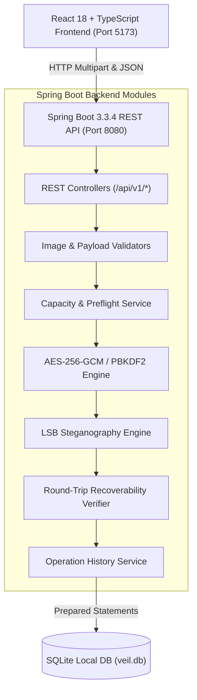

# VEIL — Secure Digital Steganography Platform

> **Hide the message. Protect its meaning.**
> An offline-first steganography workspace for embedding encrypted data in images, recovering protected payloads, and understanding the security of every operation.

---

## Highlights & Features

- **Authenticated Encryption**: Uses standard **AES-256-GCM** to guarantee both payload confidentiality and tamper detection via 128-bit authentication tags.
- **Hardened Key Derivation**: **PBKDF2-HMAC-SHA-256** with 100,000 iterations to resist dictionary and brute-force attacks.
- **Pure Java Steganography**: Sequential Red, Green, and Blue channel LSB modulation (preserving Alpha to eliminate transparency glitches).
- **Text & Binary File Payloads**: Supports Unicode text (Hindi, Chinese, Emoji) and arbitrary binary files (PDF, ZIP, DOCX) with path-traversal sanitization.
- **Preflight Capacity Verification**: Real-time server-side capacity checks with visual `CapacityRing` and preflight report before embedding.
- **Automated Recoverability Verification**: Automatically reopens and decodes exported PNG images in-memory to confirm payload recoverability before offering the download.
- **Interactive Image Comparison**: Draggable before-and-after image slider, amplified difference heatmap, and real-time PSNR and MSE metric calculation.
- **Interactive Steganography Explorer**: Educational bit-plane workbench demonstrating LSB modulation and explaining framing requirements.
- **Local SQLite History**: Persists audit metadata without ever storing passwords, encryption keys, or secret messages.
- **Global Command Palette**: Quick keyboard navigation via <kbd>Cmd</kbd>/<kbd>Ctrl</kbd> + <kbd>K</kbd>.

---

## Technology Stack

| Layer | Technology | Version | Purpose |
|---|---|---|---|
| **Frontend** | React | 18.3.1 | Component-driven web interface |
| **Language** | TypeScript | 5.6.3 | Type-safe frontend architecture |
| **Build Tool** | Vite | 5.4.8 | Fast dev server and optimized production bundling |
| **Styling** | Tailwind CSS | 3.4.13 | Midnight navy / Dark slate design system |
| **Animations** | Framer Motion | 11.11.11 | Smooth page transitions and microinteractions |
| **Icons** | Lucide React | 0.453.0 | Cohesive icon system |
| **Backend** | Java | 21 / 22 | Core cryptographic and steganographic engine |
| **Framework** | Spring Boot | 3.3.4 | REST API and modular application services |
| **API Docs** | Springdoc OpenAPI | 2.6.0 | Swagger UI and OpenAPI 3.0 documentation |
| **Cryptography** | JCA (Java Cryptography) | Native | AES-256-GCM & PBKDF2-HMAC-SHA-256 |
| **Database** | SQLite 3 | 3.46.1.0 | Local operation history |
| **Data Access** | Spring JDBC & HikariCP | 3.3.4 | Parameterized SQL prepared statements |
| **Testing** | JUnit 5 & Vitest | Latest | Automated backend, frontend, and integration tests |

---

## Architecture Diagram



---

## Getting Started

### Prerequisites
- **Java 21 LTS** or newer (`java -version`)
- **Node.js v18+** (`node -v`)
- **npm v9+** (`npm -v`)

### Quick Start (Concurrent Development)
From the repository root:
```bash
chmod +x scripts/*.sh
./scripts/dev.sh
```

### Manual Execution

#### 1. Start Java Backend
```bash
cd backend
./mvnw spring-boot:run
```
Backend will start on `http://127.0.0.1:8080`.
- Swagger UI: `http://127.0.0.1:8080/api/v1/swagger-ui.html`
- Health check: `http://127.0.0.1:8080/api/v1/health`

#### 2. Start React Frontend
In a separate terminal:
```bash
cd frontend
npm install
npm run dev
```
Frontend will be available at `http://127.0.0.1:5173`.

---

## Automated Test Suites

### Backend Unit & Integration Tests (JUnit 5)
```bash
cd backend
./mvnw test
```
*Current status: 28 tests passing (0 failures, 0 errors, 0 skipped).*

### Frontend Component Tests (Vitest)
```bash
cd frontend
npm test
```
*Current status: 8 tests passing.*

### Production Build
```bash
# Frontend production bundle
cd frontend && npm run build

# Backend production executable JAR
cd ../backend && ./mvnw clean package -DskipTests
```

---

## Security Model & Threat Disclosures

| Guarantee | Description |
|---|---|
| **Confidentiality** | Payload is encrypted with AES-256-GCM prior to embedding. |
| **Authentication** | 128-bit authentication tag detects any bit alterations or incorrect passwords. |
| **Local Privacy** | Zero cloud telemetry. All operations run locally; passwords and secrets are never persisted to SQLite. |
| **Limitation: Lossy Compression** | LSB steganography will not survive lossy compression (JPEG, WhatsApp, social media recompression). Always share stego files as lossless PNG documents. |
| **Limitation: Statistical Steganalysis** | Spatial LSB embedding is visually invisible ($> 50$ dB PSNR), but can be detected by statistical steganalysis tools (Chi-Square). |

---

## Monorepo Layout

```text
veil/
├── backend/                  # Java 21 Spring Boot application
│   ├── src/main/java/com/veil/
│   │   ├── config/           # CORS, OpenAPI, SQLite database config
│   │   ├── controller/       # REST API endpoints
│   │   ├── crypto/           # AES-GCM and PBKDF2 primitives
│   │   ├── steganography/    # LSB encoder, decoder, bit streams
│   │   ├── payload/          # BinaryEnvelope, framing codecs
│   │   ├── image/            # Image validator, capacity calculator, diff metrics
│   │   ├── repository/       # SQLite operation history repository
│   │   └── service/          # Steganography, encryption, capacity services
│   └── src/test/java/        # Comprehensive JUnit 5 and integration tests
├── frontend/                 # React 18 TypeScript application
│   ├── src/
│   │   ├── app/              # App root, ThemeProvider, ToastProvider
│   │   ├── components/       # Shared UI, dropzones, sliders, capacity ring
│   │   ├── features/         # Workspaces: Hide, Extract, Compare, Security, History, Explorer
│   │   └── services/         # Typed REST client
│   └── dist/                 # Production build bundle
├── docs/                     # Technical documentation suite
├── scripts/                  # One-click startup and test scripts
└── LICENSE                   # Apache 2.0 Open Source License
```

---

## License

Licensed under the **Apache License, Version 2.0**. See [LICENSE](LICENSE) for details.
