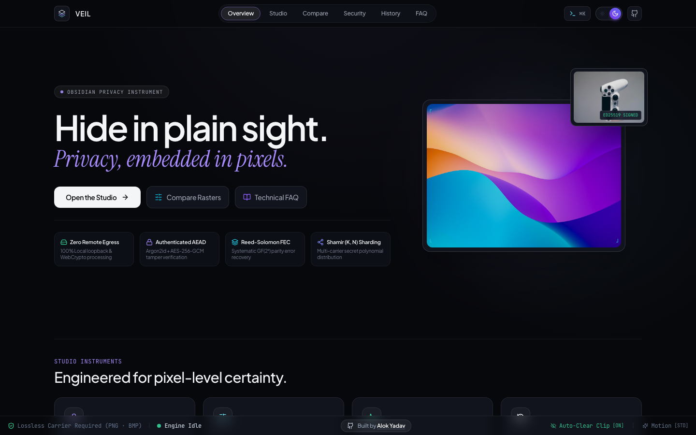
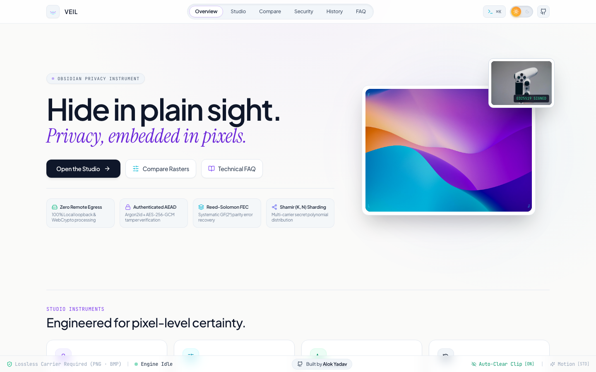
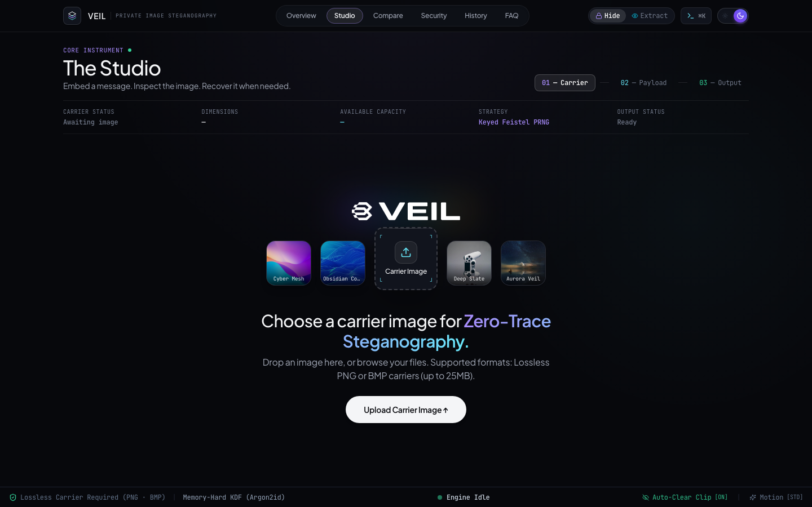
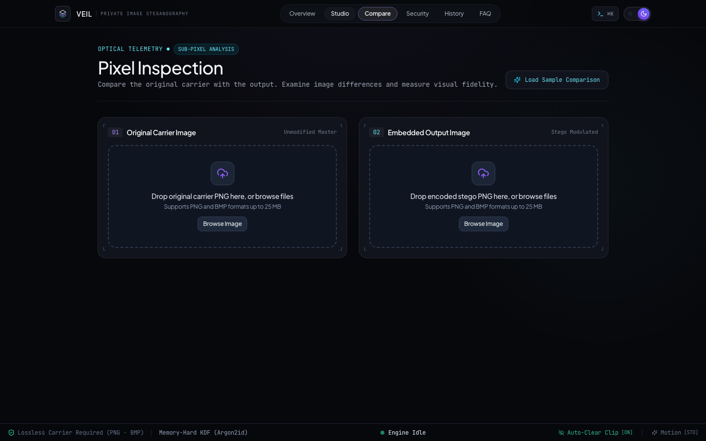
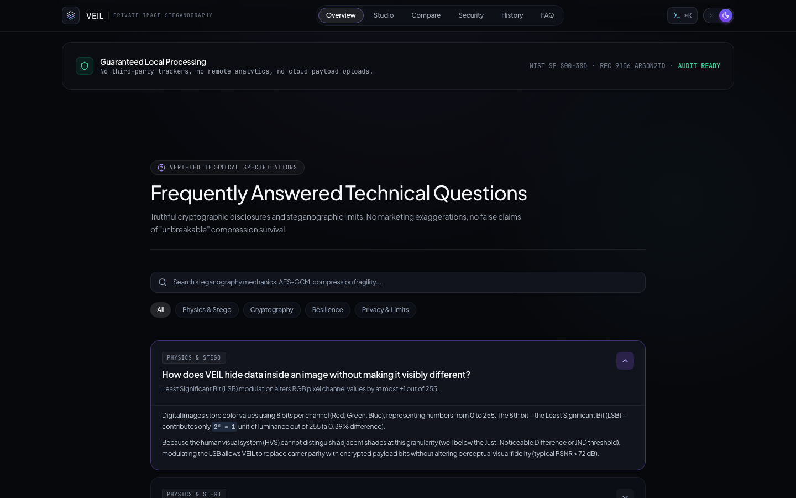
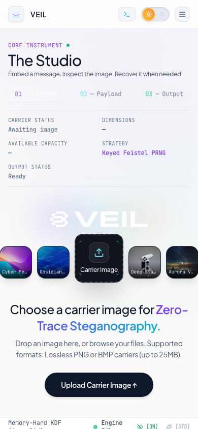
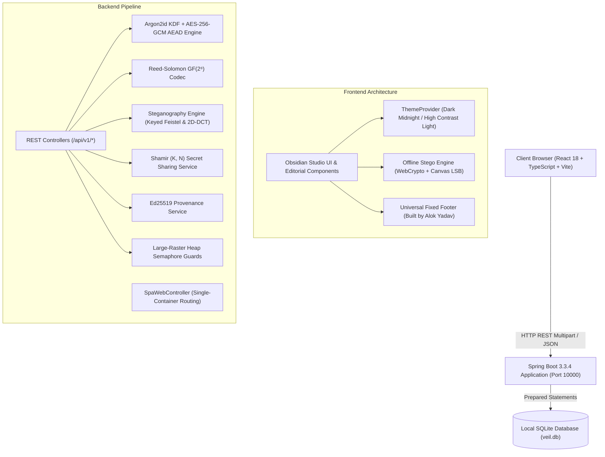

<div align="center">

# VEIL

### Privacy, embedded in pixels.

An obsidian-grade, privacy-first digital image steganography platform and cryptographic telemetry studio. Conceal authenticated, AES-256-GCM encrypted payloads inside losslessly encoded carrier images with zero cloud egress, plausible deniability, error correction, and multi-carrier secret distribution.

<br />

[](https://veil-20l2.onrender.com)
[](https://github.com/Alok-Yadav25)

<br />

[](backend)
[](frontend)
[-blue?style=flat-square&logo=typescript)](frontend)
[](backend)
[](backend)
[](frontend)
[](frontend)
[](LICENSE)

<br />

🌐 **Live Application:** [**https://veil-20l2.onrender.com**](https://veil-20l2.onrender.com)  
👤 **Author:** [**Alok Yadav (@Alok-Yadav25)**](https://github.com/Alok-Yadav25)

<br />



</div>

---

## Table of Contents

- [Live Deployment](#live-deployment)
- [Overview & Philosophy](#overview--philosophy)
- [Visual Interface Showcase](#visual-interface-showcase)
- [Key Architectural Pillars](#key-architectural-pillars)
  - [1. Authenticated Cryptography & Framing](#1-authenticated-cryptography--framing)
  - [2. Dual-Domain Steganography (Spatial LSB & 2D-DCT)](#2-dual-domain-steganography-spatial-lsb--2d-dct)
  - [3. Pure-Java Reed-Solomon Error Correction (FEC)](#3-pure-java-reed-solomon-error-correction-fec)
  - [4. Dual-Payload Plausible Deniability](#4-dual-payload-plausible-deniability)
  - [5. Multi-Carrier Secret Sharding (Shamir K-of-N)](#5-multi-carrier-secret-sharding-shamir-k-of-n)
  - [6. Pixel-Exact Ed25519 Provenance Attribution](#6-pixel-exact-ed25519-provenance-attribution)
  - [7. Air-Gapped Client-Side Processing](#7-air-gapped-client-side-processing)
- [System Architecture](#system-architecture)
- [Design System & Interface Tokens](#design-system--interface-tokens)
- [Getting Started](#getting-started)
  - [Prerequisites](#prerequisites)
  - [Local Development Setup](#local-development-setup)
  - [Running Automated Test Suites](#running-automated-test-suites)
- [Cloud Deployment on Render](#cloud-deployment-on-render)
- [Cryptographic Disclosures & Threat Model](#cryptographic-disclosures--threat-model)
- [Monorepo Directory Layout](#monorepo-directory-layout)
- [Author & Credits](#author--credits)
- [License](#license)

---

## Live Deployment

VEIL is deployed and accessible worldwide as a unified production container on Render:

🔗 **Production Web Application:** [**https://veil-20l2.onrender.com**](https://veil-20l2.onrender.com)

- **Architecture:** Multi-stage production container packaging the React 18 TypeScript SPA inside a lightweight Eclipse Temurin 21 Alpine JRE.
- **Data Protection:** Zero remote analytics, zero third-party trackers, zero cloud payload uploads. Plaintext payloads and encryption passphrases never touch persistent disk.
- **Client Fallback:** If internet connectivity is severed, VEIL's WebCrypto engine executes entirely client-side inside the browser.

---

## Overview & Philosophy

**VEIL** was designed to solve a fundamental problem in privacy-focused communication: **encryption protects the confidentiality of a message, but does not hide the fact that communication is occurring.** In hostile network environments, transmitting ciphertext invites scrutiny, interception, or coercion.

VEIL conceals authenticated, encrypted data directly within the pixel raster of digital images. To visual inspection, automated screen capture, and non-forensic pipelines, a VEIL stego image is indistinguishable from its pristine master ($\text{PSNR} > 75\text{ dB}$).

### Core Design Principles
- **No Fabricated Claims:** Zero marketing buzzwords or false claims of "unbreakable" lossy compression survival. Physical and mathematical limits are explicitly disclosed.
- **Zero Server Retention:** Plaintext payloads and passphrases are processed in volatile memory only and zeroized immediately upon completion.
- **Auditable Cryptographic Standards:** Built strictly upon NIST SP 800-38D (AES-GCM), RFC 9106 (Argon2id), RFC 8032 (Ed25519), and Reed-Solomon $GF(2^8)$ coding.
- **Obsidian Aesthetic:** Linear and Raycast-inspired interface with tactile spring physics, high-contrast typography, and seamless light/dark modes.

---

## Visual Interface Showcase

<div align="center">

### High-Contrast Light Theme (`#FAFAF9`)
*Tactile sliding knob, pure white card surfaces, slate hairline dividers, and persistent bottom telemetry footer.*



<br />

### The Steganography Studio (6-Stage Progressive Pipeline)
*Fanned carrier gallery, reticle upload dropzone, real-time bit capacity ring, and Argon2id parameter telemetry.*



<br />

### Sub-Pixel Inspection & Difference Heatmap Instrument
*Synchronized split-curtain slider, 10× difference mask amplification, PSNR ($80.89\text{ dB}$), and MSE ($0.000530$).*



<br />

### Technical FAQ Accordion & Truthful Disclosures
*Accessible expanding accordion (`Faq4` style) with real-time search and rigorous physical and cryptographic answers.*



<br />

### Mobile Viewport Ergonomics (390 × 844)
*Strict viewport boundaries, stacked action triggers, slide-over navigation drawer, and compact sliding theme toggle.*



</div>

---

## Key Architectural Pillars

### 1. Authenticated Cryptography & Framing
- **Memory-Hard Key Derivation:** Employs **Argon2id** (RFC 9106) with a 16-byte cryptographically secure random salt, requiring 19 MiB working memory, 2 iterations, and 1 lane to neutralize parallelized ASIC/GPU brute-force attacks.
- **Authenticated Encryption with Associated Data (AEAD):** Plaintext is encrypted with **AES-256-GCM** using unique 96-bit initialization vectors. The resulting 128-bit authentication tag guarantees that modifying even a single carrier bit triggers an immediate authentication rejection during extraction.
- **Big-Endian Binary Framing:** Payloads use strict binary length prefixing (`magic [4B]`, `version [2B]`, `flags [2B]`, `length [4B]`, `salt [16B]`, `iv [12B]`), preventing premature stream truncation from interior null bytes (`0x00`).

### 2. Dual-Domain Steganography (Spatial LSB & 2D-DCT)
- **Keyed Feistel PRNG Scatter (Spatial):** Replaces naive sequential pixel writing with a pseudo-random permutation generator derived from the encryption key. Payload bits are scattered pseudo-randomly across non-contiguous pixels, preventing spatial boundary clustering detectable by Chi-Square ($\chi^2$) analysis.
- **2D-DCT Frequency-Domain Modulation:** For lossy-resistant embedding, VEIL transforms $8\times 8$ luminance ($Y$) blocks into frequency coefficients via 2D Discrete Cosine Transform, modulating mid-frequency AC coefficients ($AC_{3,1}$ and $AC_{4,0}$) to survive moderate post-processing.

### 3. Pure-Java Reed-Solomon Error Correction (FEC)
- **In-House Pure-Java Codec:** Implemented over Galois Field $GF(2^8)$ with irreducible generator polynomial $p(x) = x^8 + x^4 + x^3 + x^2 + 1$ ($0x11D$).
- **Parity Error Recovery:** Generates systematic parity symbols across chunked payload blocks. Automatically detects and corrects up to $T = \lfloor(N - K) / 2\rfloor$ corrupted bytes caused by image noise, channel degradation, or minor spatial modifications.

### 4. Dual-Payload Plausible Deniability
- **Coercion Resistance:** Solves the duress problem by interleaving two independent cryptographic payloads into orthogonal bit-planes of the same carrier image.
- **Decoy vs. Secret:** Providing **Passphrase A** decrypts a benign decoy message. Providing **Passphrase B** decrypts the sensitive secret message. The hidden channel is indistinguishable from random LSB noise, mathematically denying proof of a second secret's existence.

### 5. Multi-Carrier Secret Sharding (Shamir K-of-N)
- **Threshold Polynomial Secret Distribution:** Breaks sensitive secrets into $N$ polynomial shares over $GF(2^8)$ and embeds each share in an independent carrier image.
- **Information-Theoretic Security:** Any $K$ carrier images can fully reconstruct the original secret. An adversary possessing $K - 1$ images gains strictly zero mathematical information about the payload.

### 6. Pixel-Exact Ed25519 Provenance Attribution
- **Authorship Verification:** Generates RFC 8032 Ed25519 public/private keypairs to sign the SHA-256 raster hash of carrier images.
- **Tamper Detection:** Allows recipients to verify author identity and detect single-bit pixel tampering through an embedded digital provenance manifest.

### 7. Air-Gapped Client-Side Processing
- **100% In-Browser Engine:** Provides client-side fallback via the W3C Web Cryptography API (`SubtleCrypto` AES-GCM and PBKDF2) and HTML5 Canvas pixel manipulation.
- **Severed Network Operation:** Sensitive operations can execute completely offline with network access disabled.

---

## System Architecture



---

## Design System & Interface Tokens

| Token | Dark Midnight | High Contrast Light | Semantic Purpose |
| :--- | :--- | :--- | :--- |
| **Canvas Background** | `#07080C` | `#FAFAF9` | Primary viewport canvas |
| **Workspace Shell** | `#0B0D13` | `#F4F4F5` | Understated workspace backdrop |
| **Card Surface** | `#11141D` | `#FFFFFF` | Bento cards with 1px border highlight |
| **Structural Borders** | `rgba(255,255,255,0.08)` | `rgba(0,0,0,0.08)` | Hairline dividers and grid lines |
| **Primary Accent** | `#A78BFA` (Electric Violet) | `#7C3AED` (Deep Violet) | Active pills, links, key metrics |
| **Secondary Accent** | `#67E8F9` (Luminous Cyan) | `#0284C7` (Sky Blue) | Inspection reticles, capacity bars |
| **Success Status** | `#34D399` | `#16A34A` | Verification badges, engine online |
| **Primary CTA** | High-contrast `#F4F5F7` | Pitch `#09090B` | Inverted primary action buttons |

---

## Getting Started

### Prerequisites
- **Java 21 LTS** or newer (`java -version`)
- **Node.js v18+** (`node -v`)
- **npm v9+** (`npm -v`)
- Optional: **Docker** (`docker -v`)

### Local Development Setup

#### Quick Start (Single Command)
Run both the Spring Boot backend and Vite frontend concurrently:
```bash
chmod +x scripts/*.sh
./scripts/dev.sh
```

#### Manual Execution
1. **Start the Java Backend:**
   ```bash
   cd backend
   ./mvnw spring-boot:run
   ```
   *Backend binds to `http://127.0.0.1:8080` (or `http://127.0.0.1:10000`).*
   - Swagger UI: `http://127.0.0.1:8080/api/v1/swagger-ui.html`
   - Health Endpoint: `http://127.0.0.1:8080/api/v1/health`

2. **Start the React Frontend:**
   ```bash
   cd frontend
   npm install
   npm run dev
   ```
   *Frontend opens at `http://127.0.0.1:5173`.*

---

### Running Automated Test Suites

#### Backend Unit & Integration Tests (JUnit 5)
Executes all 62 cryptographic, Reed-Solomon, 2D-DCT, Shamir, and concurrency tests:
```bash
cd backend
./mvnw test
```
```text
Results:
Tests run: 62, Failures: 0, Errors: 0, Skipped: 0
BUILD SUCCESS (Total time: ~9s)
```

#### Frontend Component Tests (Vitest)
Executes all 17 component, theme switcher, hero section, and FAQ tests:
```bash
cd frontend
npm test
```
```text
Test Files  3 passed (3)
Tests       17 passed (17)
```

#### TypeScript Typecheck & Production Build
```bash
cd frontend
npx tsc --noEmit
npm run build
```

---

## Cloud Deployment on Render

VEIL is pre-configured with a multi-stage production [`Dockerfile`](file:///Users/alokyadav/Desktop/image_detail/Dockerfile) and [`render.yaml`](file:///Users/alokyadav/Desktop/image_detail/render.yaml) blueprint.

### Live Production Deployment
- **URL:** [https://veil-20l2.onrender.com](https://veil-20l2.onrender.com)
- **Host:** Render Web Service (Free Tier)
- **Runtime:** Multi-Stage Docker (Eclipse Temurin JRE 21 + Alpine Linux)
- **Memory Optimization:** Tuned with `-Xms128m -Xmx350m -XX:+TieredCompilation -XX:TieredStopAtLevel=1` for fast cold starts without out-of-memory faults.

### Deploying Your Own Instance
1. Fork or push this repository to GitHub.
2. Sign in to [Render.com](https://render.com) and click **New +** $\to$ **Web Service**.
3. Select your repository and choose **Docker** runtime on the **Free** plan.
4. Add environment variables:
   - `SERVER_ADDRESS` = `0.0.0.0`
   - `SQLITE_DB_PATH` = `/app/data/veil.db`
5. Click **Create Web Service**. Render builds the image and deploys within 2–3 minutes.

*See the full [Free Deployment Guide](docs/architecture/free_deployment_guide.md) for Koyeb, Hugging Face Spaces, and Fly.io configurations.*

---

## Cryptographic Disclosures & Threat Model

| Property | What VEIL Guarantees | What It Does NOT Guarantee |
| :--- | :--- | :--- |
| **Payload Secrecy** | Encrypted with AES-256-GCM derived via Argon2id. Computationally infeasible to decrypt without passphrase. | Does not protect weak passwords against offline dictionary attacks if password entropy is poor. |
| **Data Integrity** | 128-bit GCM authentication tag immediately detects any carrier pixel tampering or password mismatch. | Cannot recover lost passphrases. There are zero backdoors or master escrow keys. |
| **Visual Invisibility** | Modulates LSB parity below human Just-Noticeable Difference (typical $\text{PSNR} > 75\text{ dB}$). | Does not survive lossy compression (JPEG, WhatsApp recompression). Spatial LSB requires lossless PNG/BMP. |
| **Steganalysis Resistance** | Keyed Feistel PRNG scatter prevents sequential Chi-Square ($\chi^2$) analysis detection. | High payload ratios ($> 20\%$) remain statistically distinguishable by high-dimensional deep-learning classifiers. |
| **Digital Provenance** | Ed25519 signature guarantees raster has not been altered since author signed it. | Does not prove the image depicts real-world physical events or wasn't AI-generated prior to signing. |

---

## Monorepo Directory Layout

```text
veil/
├── backend/                              # Java 21 Spring Boot Application
│   ├── src/main/java/com/veil/
│   │   ├── config/                       # CORS, SQLite WAL, OpenAPI documentation
│   │   ├── controller/                   # REST API & SPA route forwarding controllers
│   │   ├── crypto/                       # Argon2id, HKDF, AES-256-GCM primitives
│   │   ├── deniability/                  # Dual-payload plausible deniability engine
│   │   ├── fec/                          # Pure-Java Reed-Solomon GF(2⁸) codec
│   │   ├── image/                        # Capacity calculator, sub-pixel difference metrics
│   │   ├── payload/                      # BinaryEnvelope, versioned framing codecs
│   │   ├── provenance/                   # Ed25519 digital signature signing & verification
│   │   ├── repository/                   # SQLite operation history repository
│   │   ├── service/                      # Core steganography, encryption, and analysis services
│   │   ├── sharing/                      # Shamir (K, N) secret sharing polynomial engine
│   │   └── steganography/                # Keyed scatter, sequential LSB, and 2D-DCT strategies
│   └── src/test/java/com/veil/           # 62 unit, integration, and benchmark tests
├── frontend/                             # React 18 TypeScript Web Studio
│   ├── src/
│   │   ├── app/                          # App root, ThemeProvider, ToastProvider
│   │   ├── components/
│   │   │   ├── brand/                    # VEIL vector logos and brand symbols
│   │   │   ├── landing/                  # Editorial HeroSection & FaqSection accordion
│   │   │   ├── layout/                   # AppShell, Linear navigation, BottomStatusBar (Author link)
│   │   │   ├── navigation/               # CommandPalette (⌘K), Sidebar
│   │   │   ├── studio/                   # 6-stage progressive choreography components
│   │   │   └── ui/                       # Spring ThemeSwitcher knob, BentoCard, PillBadge
│   │   ├── features/                     # Studio, Compare, Security, History, Explorer, Provenance
│   │   ├── services/                     # Typed REST API client
│   │   └── utils/                        # Air-gapped offline steganography engine
│   └── dist/                             # Optimized Vite production build bundle
├── docs/                                 # Technical documentation & image assets
│   ├── images/                           # Full-fidelity interface screenshots
│   ├── architecture/                     # System design and deployment guides
│   ├── cryptography/                     # Cryptographic specifications & proofs
│   └── steganography/                    # Steganographic limits & benchmarking reports
├── scripts/                              # Local automation and startup scripts
├── Dockerfile                            # Multi-stage production container
├── render.yaml                           # 1-Click Render.com deployment blueprint
└── LICENSE                               # Apache 2.0 Open Source License
```

---

## Author & Credits

Designed, architected, and built by:

**Alok Yadav**
- 🐙 **GitHub:** [@Alok-Yadav25](https://github.com/Alok-Yadav25)
- 🚀 **Live Project:** [https://veil-20l2.onrender.com](https://veil-20l2.onrender.com)
- 📦 **Repository:** [https://github.com/Alok-Yadav25/VEIL](https://github.com/Alok-Yadav25/VEIL)

---

## License

Licensed under the **Apache License, Version 2.0** (the "License"). You may obtain a copy of the License at:

```
http://www.apache.org/licenses/LICENSE-2.0
```

Unless required by applicable law or agreed to in writing, software distributed under the License is distributed on an "AS IS" BASIS, WITHOUT WARRANTIES OR CONDITIONS OF ANY KIND, either express or implied. See the License for the specific language governing permissions and limitations under the License.
