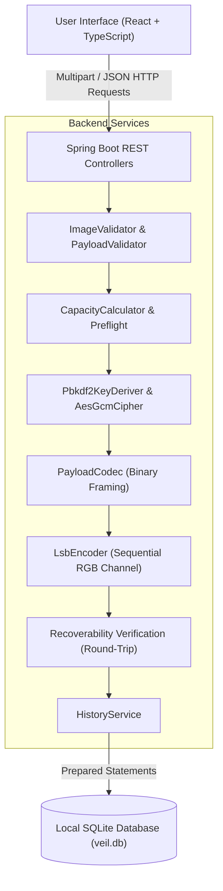

# VEIL Architecture Documentation

## System Overview

VEIL is an offline-first full-stack secure digital steganography platform. It enables users to encrypt text messages or binary files using AES-256-GCM, derive keys using PBKDF2-HMAC-SHA-256 with 100,000 rounds, embed the resulting versioned binary envelope into the least-significant bits (LSBs) of carrier images (PNG / BMP), and extract/authenticate payloads with mathematical guarantees.

## Monorepo Architecture

```text
veil/
├── frontend/             # React 18, TypeScript, Tailwind CSS, Framer Motion, Lucide React
│   ├── src/
│   │   ├── app/          # Root App component, ThemeProvider, ToastProvider, ErrorBoundary
│   │   ├── components/   # Reusable UI (Button, Card, Modal, PasswordField, ImageDropzone, CapacityRing, ImageCompareSlider)
│   │   ├── features/     # Workspaces (Dashboard, HideData, ExtractData, CapacityAnalyzer, Inspector, Compare, Security, History, Explorer, Settings)
│   │   ├── services/     # Centralized typed REST client
│   │   └── types/        # Full TypeScript definitions
│   └── dist/             # Production build output
│
├── backend/              # Spring Boot 3.3.4, Java 21, SQLite JDBC, Springdoc OpenAPI
│   ├── src/main/java/com/veil/
│   │   ├── config/       # WebMvc (CORS), OpenApi, DatabaseConfig, VeilProperties
│   │   ├── controller/   # Health, Steganography, Image, Security, History
│   │   ├── service/      # SteganographyService, EncryptionService, CapacityService, HistoryService, KeyDerivationService
│   │   ├── crypto/       # AesGcmCipher, Pbkdf2KeyDeriver, CryptoConstants
│   │   ├── steganography/# LsbEncoder, LsbDecoder, StegoConstants
│   │   ├── payload/      # BinaryEnvelope, PlaintextPayload, PayloadCodec, PayloadType
│   │   ├── image/        # ImageValidator, CapacityCalculator, ImageDiffCalculator, ImageProcessingService
│   │   ├── repository/   # OperationHistoryRepository (Prepared statements)
│   │   ├── model/        # OperationRecord, OperationType, OperationStatus, PayloadTypeEnum
│   │   ├── dto/          # Structured requests & responses
│   │   ├── exception/    # GlobalExceptionHandler & typed domain exceptions
│   │   └── util/         # FilenameSanitizer, ChecksumUtil, HexUtil
│   └── target/           # Compiled classes and packaged JAR
│
├── docs/                 # Complete technical documentation suite
├── scripts/              # Local development and build scripts
├── README.md             # Project README
└── LICENSE               # Apache 2.0 Open Source License
```

## Data Flow Diagram



## Component Boundaries

1. **Controllers**: Extremely thin. Responsible solely for HTTP mapping, multipart parsing, invoking service layers, and returning structured responses.
2. **Services**: Domain business logic. Orchestrate image reading, key derivation, AES-GCM encryption/decryption, binary framing, LSB modulation, and SQLite audit logging.
3. **Cryptography Layer**: Completely decoupled from steganography. Uses native Java Cryptography Architecture (JCA) primitives: `Cipher.getInstance("AES/GCM/NoPadding")` and `SecretKeyFactory.getInstance("PBKDF2WithHmacSHA256")`.
4. **Steganography Layer**: Responsible for bit-plane manipulation of uncompressed `BufferedImage` raster data.
5. **Database Layer**: Pure JDBC with parameterized SQL statements. Strictly records operation metadata; plaintext secrets, keys, and recovered payloads are never persisted.
