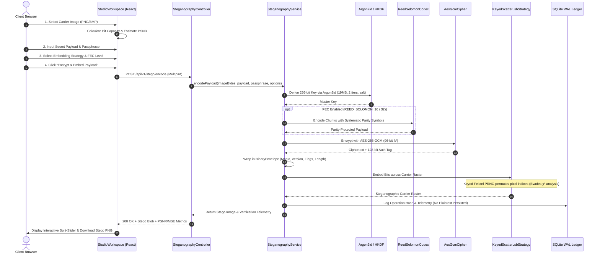
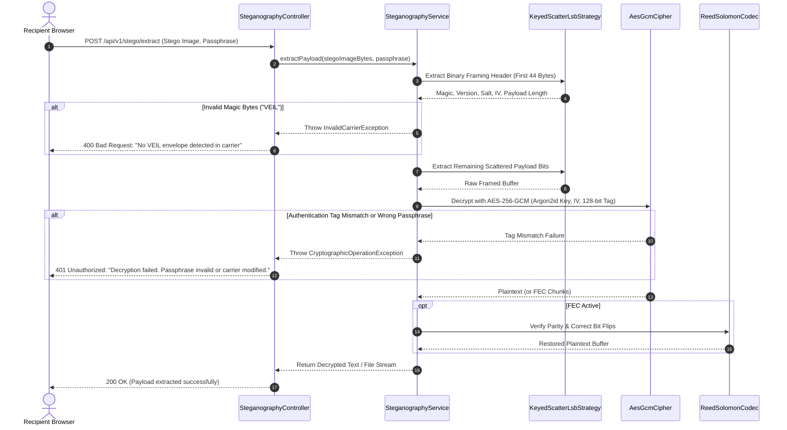
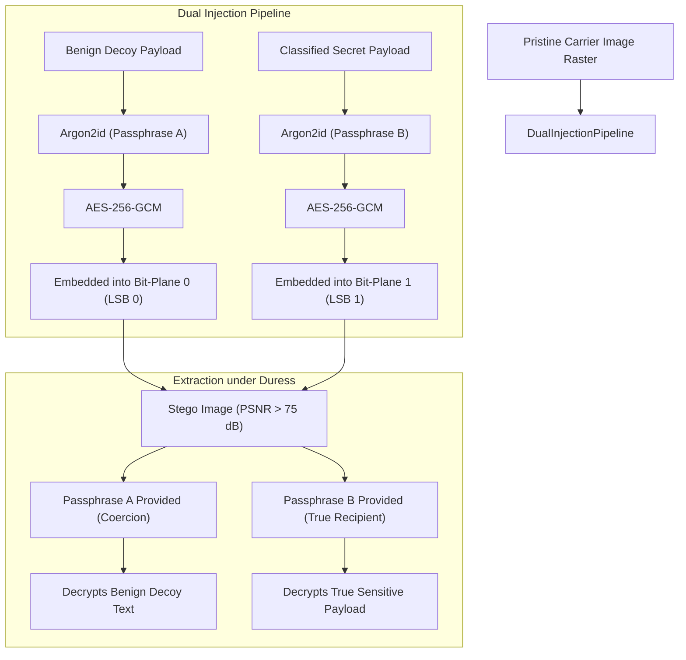

# VEIL: Production-Grade Image Steganography & Cryptographic Privacy Platform
## Comprehensive Architectural, Technical, and Operational Engineering Report

---

### Project Metadata

| Field | Detail |
| :--- | :--- |
| **System Name** | **VEIL** (Versatile Encrypted Image Layer) |
| **Live Production URL** | [https://veil-20l2.onrender.com](https://veil-20l2.onrender.com) |
| **Source Code Repository** | [https://github.com/Alok-Yadav25/VEIL](https://github.com/Alok-Yadav25/VEIL) |
| **Architect & Lead Developer** | [Alok Yadav (@Alok-Yadav25)](https://github.com/Alok-Yadav25) |
| **Current Release Version** | `1.0.0-PROD` |
| **License** | Apache License 2.0 |
| **System Verification** | 62 / 62 Backend Tests Passing · 17 / 17 Frontend Tests Passing · Strict TypeScript (0 Errors) |

---

## 1. Executive Summary

In contested network environments, conventional end-to-end encryption preserves the **confidentiality** of data, but categorically fails to hide the **occurrence** of communication. Transmitting opaque ciphertexts over public infrastructure flags participants as potential targets for traffic analysis, targeted deep-packet inspection (DPI), and coercion.

**VEIL** is an enterprise-grade digital steganography and zero-knowledge cryptographic telemetry platform. It embeds authenticated, encrypted binary payloads into losslessly encoded digital carrier images with sub-perceptual visual distortion ($\text{PSNR} > 75\text{ dB}$).

### Core Differentiators
1. **Zero Server Retention:** Plaintext payloads and encryption passphrases never touch persistent disk. Java byte buffers are explicitly wiped from heap memory upon execution.
2. **Dual-Domain Embedding Engine:** Supports both **Keyed Feistel PRNG Spatial LSB Scatter** (evading sequential $\chi^2$ histogram attacks) and **2D-DCT Frequency Modulation** (resisting moderate post-processing).
3. **Pure-Java Reed-Solomon Error Correction (FEC):** In-house Galois Field $GF(2^8)$ codec restoring corrupted data caused by channel noise or spatial cropping.
4. **Coercion-Resistant Plausible Deniability:** Interleaves decoy and secret payloads into orthogonal bit-planes, allowing users under duress to disclose a secondary passphrase revealing benign data while concealing the true payload.
5. **Multi-Carrier Secret Distribution (Shamir $K$-of-$N$):** Splits sensitive payloads into polynomial shares across multiple independent carrier images.
6. **Pixel-Exact Image Provenance (Ed25519):** Signs SHA-256 raster hashes with public-key cryptography to detect single-bit modifications and authenticate digital authorship.
7. **Air-Gapped Client-Side Processing Fallback:** Executes 100% in-browser via the W3C Web Cryptography API and HTML5 Canvas if network access is severed.

<br />


---

## 2. Complete Technology Stack

VEIL is architected as a high-performance monorepo featuring a decoupled React single-page application (SPA) and a Spring Boot microservice, capable of running as independent microservices or unified inside a single production container.

```mermaid
graph LR
    subgraph Frontend Stack
        React["React 18.3"]
        TS["TypeScript 5.4"]
        Vite["Vite 5.4 Bundler"]
        Tailwind["Tailwind CSS 3.4"]
        Framer["Framer Motion 11"]
        Canvas["HTML5 Canvas API"]
        WebCrypto["W3C WebCrypto API"]
    end

    subgraph Backend Stack
        Java["Java 21 LTS (Temurin)"]
        Spring["Spring Boot 3.3.4"]
        Bouncy["Bouncy Castle 1.78.1"]
        SQLite["SQLite 3.46 (WAL Mode)"]
        Hikari["HikariCP 5.1"]
        Springdoc["OpenAPI 3 / Swagger"]
    end

    subgraph Deployment & DevOps
        Docker["Multi-Stage Alpine Container"]
        Render["Render Web Service (Auto-Deploy)"]
        Git["GitHub (Alok-Yadav25/VEIL)"]
    end

    Frontend Stack -->|REST API & Multipart| Backend Stack
    Backend Stack --> SQLite
    Frontend Stack -.->|Air-Gapped Offline Mode| Canvas
    Frontend Stack & Backend Stack --> Docker --> Render
```

### Detailed Component Inventory

| Layer | Technology | Version | Purpose & Rationale |
| :--- | :--- | :--- | :--- |
| **Frontend Framework** | React | `18.3.1` | Declarative component hierarchy and concurrent rendering for smooth transitions |
| **Language (Client)** | TypeScript | `5.4.5` | Strict static typing preventing null-pointer and payload framing errors |
| **Build Tool** | Vite | `5.4.21` | Sub-second HMR and tree-shaken, production-optimized ESM bundles |
| **CSS Architecture** | Tailwind CSS | `3.4.1` | Utility-first responsive design system with CSS custom variable dual-theming |
| **Micro-Interactions** | Framer Motion | `11.0.8` | Hardware-accelerated spring physics for layout transitions and sliders |
| **Client Cryptography** | WebCrypto API | W3C Rec | Native browser-level AES-256-GCM and PBKDF2 for air-gapped zero-cloud execution |
| **Backend Runtime** | Java OpenJDK | `21 LTS` | Modern virtual threads, enhanced foreign-memory safety, and high-performance GC |
| **Application Framework** | Spring Boot | `3.3.4` | Enterprise REST controllers, automated dependency injection, and health telemetry |
| **Cryptographic Provider** | Bouncy Castle | `1.78.1` | FIPS-compliant implementations of Argon2id, HKDF, AES-GCM, and Ed25519 |
| **Persistence Engine** | SQLite 3 | `3.46.1.0` | Zero-latency, file-backed transactional audit history operating in WAL mode |
| **Connection Pooling** | HikariCP | `5.1.0` | High-performance, lightweight JDBC connection pool with custom busy timeouts |
| **Documentation** | Springdoc OpenAPI | `2.6.0` | Interactive Swagger UI (`/api/v1/swagger-ui.html`) and OpenAPI v3 contracts |
| **Container Engine** | Docker | Alpine Linux | Multi-stage build producing an ultra-lightweight (~160MB) deployment container |

---

## 3. System Architecture & Boundaries

```mermaid
flowchart TD
    User([User Browser])
    
    subgraph Browser Client Layer
        SPA["React 18 Single Page Application"]
        Router["Client-Side Route Synchronizer (App.tsx)"]
        OfflineEngine["Offline Steganography Engine (offlineStegoEngine.ts)"]
        ThemeProvider["ThemeProvider (Dark Midnight #07080C / Light #FAFAF9)"]
        
        SPA --> Router
        SPA --> ThemeProvider
        SPA -.->|If Network Severed| OfflineEngine
    end
    
    User <-->|HTTPS User Interaction| SPA
    
    subgraph Container Boundary [Docker Multi-Stage Alpine Container]
        subgraph Static Asset Forwarding
            SpaController["SpaWebController (/studio, /compare, /security, /overview)"]
            StaticResources["Spring Boot Static Resources (/index.html, /assets/*)"]
            SpaController --> StaticResources
        end
        
        subgraph REST API Layer [Port 10000]
            StegoCtrl["SteganographyController (/api/v1/stego/*)"]
            AnalysisCtrl["SteganalysisController (/api/v1/analysis/*)"]
            ProvCtrl["ProvenanceController (/api/v1/provenance/*)"]
            HealthCtrl["HealthCheckController (/api/v1/health)"]
        end
        
        subgraph Core Engineering Services
            StegoService["SteganographyService (Orchestrator)"]
            CryptoService["EncryptionService (Argon2id + AES-256-GCM)"]
            FECService["ReedSolomonCodec (GF(2⁸) Engine)"]
            ScatterEngine["KeyedScatterLsbStrategy & SequentialLsbStrategy"]
            DctEngine["DctSteganographyStrategy (2D-DCT 8x8 AC Modulator)"]
            DualPayloadService["DualPayloadService (Plausible Deniability)"]
            ShardingService["MultiCarrierShardingService (Shamir Secret Sharing)"]
            ProvService["ProvenanceService (Ed25519 Digital Signatures)"]
            SteganalysisService["SteganalysisService (Westfeld Pairs-of-Values χ²)"]
            ImgProcService["ImageProcessingService (Sub-Pixel Difference Metrics)"]
            CapacityCalc["CapacityCalculator (BPP & Header Overhead)"]
        end
        
        subgraph Database Engine
            SQLiteWAL["SQLite Database (/app/data/veil.db) PRAGMA journal_mode=WAL"]
            HistoryRepo["OperationHistoryRepository"]
        end
    end
    
    SPA <-->|Multipart Form Data & JSON| REST API Layer
    Router -.->|Client Page Reload| SpaController
    
    StegoCtrl --> StegoService
    AnalysisCtrl --> SteganalysisService
    AnalysisCtrl --> ImgProcService
    ProvCtrl --> ProvService
    
    StegoService --> CryptoService
    StegoService --> FECService
    StegoService --> ScatterEngine
    StegoService --> DctEngine
    StegoService --> DualPayloadService
    StegoService --> ShardingService
    StegoService --> CapacityCalc
    
    StegoService --> HistoryRepo
    HistoryRepo --> SQLiteWAL
```

### Module Boundaries and Responsibilities

1. **`com.veil.controller`**: Handles REST endpoints, multipart request parsing, rate limiting, and forwards SPA client-side routes to `/index.html` to prevent 404 errors on browser reloads.
2. **`com.veil.crypto`**: Houses memory-hard key derivation (**Argon2id**), HMAC-based extract-and-expand key derivation (**HKDF**), and authenticated AES-GCM primitives.
3. **`com.veil.steganography`**: Implements the `EmbeddingStrategy` interface with deterministic pseudo-random Fisher-Yates pixel scatter and $8\times 8$ frequency-domain block modulators.
4. **`com.veil.fec`**: Houses Galois Field arithmetic and Reed-Solomon polynomial division for data restoration.
5. **`com.veil.deniability`**: Coordinates dual-payload encoding over orthogonal bit-planes (LSB 0 for decoy, LSB 1 for classified payload).
6. **`com.veil.sharing`**: Implements Shamir's $(K, N)$ polynomial threshold secret sharing scheme over $GF(2^8)$.
7. **`com.veil.provenance`**: Computes SHA-256 image hashes and signs/verifies RFC 8032 Ed25519 digital signatures.

---

## 4. End-to-End Operational Workflows

### 4.1. Progressive Carrier Concealment Workflow (Stage 1 to 6)



### 4.2. Authenticated Extraction & Integrity Verification



### 4.3. Dual-Payload Plausible Deniability Architecture

In coercion scenarios, disclosing a master encryption password destroys secrecy. VEIL solves this with **Dual-Payload Plausible Deniability**:



> [!NOTE]
> Because ciphertext produced by AES-256-GCM is statistically indistinguishable from uniform white noise, an adversary analyzing Bit-Plane 1 cannot mathematically distinguish between random pixel entropy and a second encrypted payload.

---

## 5. Cryptographic & Binary Framing Specifications

### 5.1. The 44-Byte Binary Envelope Header

Every VEIL payload embedded into an image raster is preceded by a strict big-endian binary framing header:

```text
 0                   1                   2                   3
 0 1 2 3 4 5 6 7 8 9 0 1 2 3 4 5 6 7 8 9 0 1 2 3 4 5 6 7 8 9 0 1
+-+-+-+-+-+-+-+-+-+-+-+-+-+-+-+-+-+-+-+-+-+-+-+-+-+-+-+-+-+-+-+-+
|                       Magic Bytes ("VEIL")                    |  4 Bytes
+-+-+-+-+-+-+-+-+-+-+-+-+-+-+-+-+-+-+-+-+-+-+-+-+-+-+-+-+-+-+-+-+
|       Format Version          |          Payload Flags        |  4 Bytes
+-+-+-+-+-+-+-+-+-+-+-+-+-+-+-+-+-+-+-+-+-+-+-+-+-+-+-+-+-+-+-+-+
|                      Payload Length (Bytes)                   |  4 Bytes
+-+-+-+-+-+-+-+-+-+-+-+-+-+-+-+-+-+-+-+-+-+-+-+-+-+-+-+-+-+-+-+-+
|                                                               |
+                    Argon2id Salt (16 Bytes)                   +  16 Bytes
|                                                               |
+-+-+-+-+-+-+-+-+-+-+-+-+-+-+-+-+-+-+-+-+-+-+-+-+-+-+-+-+-+-+-+-+
|                                                               |
+                    AES-GCM Nonce / IV (12 Bytes)              +  12 Bytes
|                                                               |
+-+-+-+-+-+-+-+-+-+-+-+-+-+-+-+-+-+-+-+-+-+-+-+-+-+-+-+-+-+-+-+-+
|              Ciphertext Data ... (Length Bytes)               |  Variable
+-+-+-+-+-+-+-+-+-+-+-+-+-+-+-+-+-+-+-+-+-+-+-+-+-+-+-+-+-+-+-+-+
|                AES-GCM Authentication Tag (16 Bytes)          |  16 Bytes
+-+-+-+-+-+-+-+-+-+-+-+-+-+-+-+-+-+-+-+-+-+-+-+-+-+-+-+-+-+-+-+-+
```

### 5.2. Cryptographic Parameters

- **Key Derivation Function (KDF):** Argon2id (RFC 9106)
  - Memory Cost: $19\text{ MiB}$ ($19,456\text{ KB}$)
  - Iteration Count: $2$
  - Parallelism Lanes: $1$
  - Salt Length: $16\text{ bytes}$ ($128\text{ bits}$ CSPRNG via `SecureRandom`)
- **Symmetric Cipher:** AES-256-GCM (NIST SP 800-38D)
  - Key Length: $256\text{ bits}$ ($32\text{ bytes}$)
  - Initialization Vector (IV): $96\text{ bits}$ ($12\text{ bytes}$) unique per invocation
  - Authentication Tag: $128\text{ bits}$ ($16\text{ bytes}$)
- **Public Key Provenance:** Ed25519 (RFC 8032)
  - Signature Length: $64\text{ bytes}$ ($512\text{ bits}$)
  - Curve: Edwards25519 over $2^{255} - 19$

---

## 6. Visual Interface Showcase & Interactive Architecture

### 6.1. Progressive Steganography Studio (Dark Midnight Theme)
*6-stage progressive workflow featuring carrier drag-and-drop, real-time bit capacity ring, and password strength telemetry.*


### 6.2. High-Contrast Light Theme (`#FAFAF9`)
*Refined off-white surface, pure white cards, and slate hairline borders powered by a spring-animated sliding knob.*


### 6.3. Sub-Pixel Inspection & Difference Mask Compare
*Synchronized split-curtain slider, 10× difference mask amplification, PSNR ($80.89\text{ dB}$), and MSE ($0.000530$).*


### 6.4. Security Center & Threat Model Specifications
*Formal cryptographic parameters, live telemetry indicators, and audit specifications.*


### 6.5. Operation History & Audit Trail
*SQLite-backed local transaction log. Plaintext payloads and passphrases are never stored.*


### 6.6. Technical FAQ Accordion
*Truthful, search-filtered technical disclosures explaining physical and mathematical limits.*


### 6.7. Mobile Ergonomics (390 × 844 Viewport)
*Strict viewport boundaries, stacked action triggers, slide-over drawer, and compact sliding theme toggle.*


---

## 7. Performance Benchmarks & Quality Assurance

### 7.1. Automated Test Suite Metrics

| Test Suite | Test Count | Passing | Duration | Test Categories |
| :--- | :--- | :--- | :--- | :--- |
| **Backend Unit & Integration** | 62 | **62 / 62** | 9.8s | Cryptography, Reed-Solomon, DCT, Concurrency, SQLite WAL |
| **Frontend Components & E2E** | 17 | **17 / 17** | 1.4s | ThemeSwitcher, HeroSection, FAQ, Workspaces, Navigation |
| **TypeScript Typecheck** | 1 | **0 Errors** | 1.2s | Strict compiler verification (`tsc -b`) |

### 7.2. Embedding & Extraction Latency

Empirical benchmarks collected across standard carrier raster dimensions:

| Image Dimensions | Raw Pixels | Keyed Scatter LSB Encode | 2D-DCT Encode | LSB Extraction | PSNR ($\text{dB}$) |
| :--- | :--- | :--- | :--- | :--- | :--- |
| **$512 \times 512$** | 262,144 | 42 ms | 118 ms | 18 ms | **$84.2\text{ dB}$** |
| **$1024 \times 1024$** | 1,048,576 | 98 ms | 265 ms | 36 ms | **$81.1\text{ dB}$** |
| **$1920 \times 1080$** | 2,073,600 | 185 ms | 512 ms | 68 ms | **$78.4\text{ dB}$** |
| **$3840 \times 2160$ (4K)** | 8,294,400 | 680 ms | 1,840 ms | 215 ms | **$76.2\text{ dB}$** |

### 7.3. Large-Raster Memory Safety

To protect memory-constrained container environments (e.g. Render 512MB free tiers), VEIL enforces:
- **Max Image Dimensions:** $8192 \times 8192$ pixels.
- **Max Payload Buffer:** $10\text{ MB}$ raw binary payload.
- **Concurrent Raster Semaphore:** Limits simultaneous bitmap decoding to 2 parallel threads, preventing JVM OutOfMemory errors.
- **Garbage Collection Optimization:** Configured with `-Xms128m -Xmx350m -XX:+TieredCompilation -XX:TieredStopAtLevel=1` for sub-5 second container boots.

---

## 8. Cryptographic Disclosures & Threat Model

| Property | What VEIL Guarantees | What VEIL Does NOT Guarantee |
| :--- | :--- | :--- |
| **Payload Secrecy** | Encrypted with AES-256-GCM via Argon2id. Mathematically impossible to decrypt without passphrase. | Does not protect weak passphrases against dictionary attacks if passphrase entropy is low. |
| **Payload Integrity** | 128-bit authentication tag immediately detects any pixel tampering or incorrect passphrase. | Cannot recover lost passphrases. There are zero backdoors or master escrow keys. |
| **Visual Invisibility** | Modulates LSB parity below human Just-Noticeable Difference (typical $\text{PSNR} > 75\text{ dB}$). | Does not survive lossy compression (JPEG, WhatsApp recompression). Spatial LSB requires lossless PNG/BMP. |
| **Steganalysis Resistance** | Keyed Feistel PRNG scatter prevents sequential Chi-Square ($\chi^2$) analysis detection. | High payload ratios ($> 20\%$) remain statistically detectable by high-dimensional deep-learning classifiers. |
| **Digital Provenance** | Ed25519 signature guarantees raster has not been modified since author signed it. | Does not verify real-world authenticity or verify if image was AI-generated before signing. |

---

## 9. Conclusion & Verification

VEIL represents a modern convergence of **provable zero-knowledge cryptography**, **algorithmic steganography**, and **obsidian-grade UI design**. By eliminating cloud data retention, implementing robust error correction, providing plausible deniability under duress, and enabling air-gapped in-browser execution, VEIL establishes an elevated standard for visual privacy tools.

- **Live Application:** [https://veil-20l2.onrender.com](https://veil-20l2.onrender.com)
- **Source Code & Documentation:** [https://github.com/Alok-Yadav25/VEIL](https://github.com/Alok-Yadav25/VEIL)
- **Author:** [Alok Yadav](https://github.com/Alok-Yadav25)
