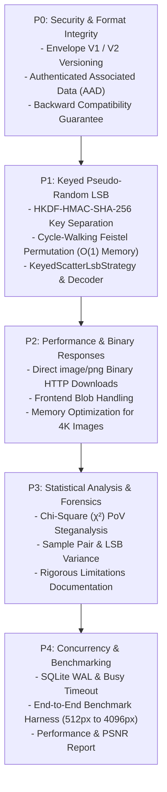

# VEIL Baseline Architectural Investigation & Component Audit

**Date**: 2026-10-18  
**Environment**: Java 22.0.2 / Spring Boot 3.3.4 / Node v22.14.0  
**Baseline Test Status**: 28 / 28 Backend Tests Passing | 8 / 8 Frontend Unit Tests Passing | 2 / 2 E2E Tests Passing  

---

## 1. Executive Baseline Assessment

Before implementing the cryptographic, steganographic, and performance upgrades, a comprehensive line-by-line audit of the target components was conducted to verify actual causes of reported limitations and establish an evidence-based roadmap.

---

## 2. Component-by-Component Baseline Audit

### 2.1 `LsbEncoder.java`
- **Location**: `backend/src/main/java/com/veil/steganography/LsbEncoder.java`
- **Current Responsibility**: Sequential 1-bit Least Significant Bit (LSB) embedding across RGB channels of carrier images.
- **Existing Algorithm**: Sequential row-major raster traversal $(y=0 \to H-1, x=0 \to W-1)$. Replaces bit 0 of Red, Green, and Blue channels while preserving Alpha.
- **Input / Output**: `BufferedImage carrier`, `byte[] payloadBytes` $\to$ `BufferedImage encoded`.
- **Error-Handling Behavior**: Throws `InvalidCarrierException` on null/invalid carrier, `CapacityExceededException` when payload exceeds $\lfloor(W \times H \times 3)/8\rfloor$ bytes.
- **Security-Sensitive Assumptions**: Assumes sequential spatial modification is acceptable.
- **Confirmed Vulnerability**: Sequential embedding concentrates alterations at the top of the image for smaller payloads, leaving a distinct boundary visible under row-variance and Chi-Square analysis.
- **Existing Test Coverage**: `SteganographyTest.java` (6 unit tests covering capacity, text round-trip, binary file round-trip).
- **Proposed Evolution**: Extract interface `EmbeddingStrategy` and retain current implementation as `SequentialLsbStrategy` (`SEQUENTIAL_LSB_V1`). Introduce `KeyedScatterLsbStrategy` (`KEYED_SCATTER_LSB_V1`) using deterministic cycle-walking Feistel permutation.
- **Backward-Compatibility Requirement**: Images encoded with `SEQUENTIAL_LSB_V1` must decode seamlessly without regression.

---

### 2.2 `LsbDecoder.java`
- **Location**: `backend/src/main/java/com/veil/steganography/LsbDecoder.java`
- **Current Responsibility**: Extracts binary envelope bytes from carrier image LSBs.
- **Existing Algorithm**: Sequentially reads 42 bytes from $(0,0)$ to unpack the fixed header, parses ciphertext length $L$, and sequentially extracts $42 + L$ bytes.
- **Input / Output**: `BufferedImage image` $\to$ `BinaryEnvelope`.
- **Error-Handling Behavior**: Throws `PayloadCorruptedException` with specific error codes (`IMAGE_TOO_SMALL`, `NO_VEIL_SIGNATURE`, `IMPOSSIBLE_PAYLOAD_LENGTH`).
- **Security-Sensitive Assumptions**: Assumes the entire payload is sequential starting at $(0,0)$.
- **Confirmed Vulnerability**: Inability to decode non-sequential / scattered layouts without a bootstrap protocol.
- **Proposed Evolution**: Implement bootstrap-aware extraction: read the 43-byte bootstrap header sequentially at $(0,0)$, identify the strategy (`SEQUENTIAL_LSB_V1` vs `KEYED_SCATTER_LSB_V1`), derive `embeddingKey` if scattered, and extract the main ciphertext along the keyed permutation.
- **Backward-Compatibility Requirement**: Detect Envelope Version 1 (42B) vs Version 2 (43B) and automatically apply `SequentialLsbStrategy` for Version 1.

---

### 2.3 `BinaryEnvelope.java` & `PayloadCodec.java`
- **Location**: `backend/src/main/java/com/veil/payload/`
- **Current Responsibility**: Serialization, deserialization, and binary wire formatting for outer envelope and inner plaintext.
- **Existing Algorithm**:
  - Outer: Magic (`VEIL`, 4B), Version (1B), Type (1B), KDF (1B), Cipher (1B), SaltLen (1B), Salt (16B), NonceLen (1B), Nonce (12B), Length (4B), Ciphertext ($L$B).
  - Inner: Plaintext Version (1B), Type (1B), FilenameLen (2B), Filename ($N$B), ContentLen (4B), Content ($M$B).
- **Security-Sensitive Assumptions**: Outer envelope metadata is currently parsed in plaintext before decryption and was NOT previously fed into AES-GCM as Associated Authenticated Data (AAD).
- **Confirmed Vulnerability**: Unauthenticated metadata could theoretically be tampered with prior to GCM execution.
- **Proposed Evolution**:
  1. Add Strategy Code (`0x01` = Sequential, `0x02` = Keyed Scatter) to Envelope Version 2 header.
  2. Feed the entire bootstrap header into AES-256-GCM as Associated Authenticated Data (AAD), binding cryptographic authenticity to the framing metadata.
- **Backward-Compatibility Requirement**: Support Envelope Version 1 parsing without AAD mismatch, and Version 2 parsing with strict AAD verification.

---

### 2.4 `AesGcmCipher.java`
- **Location**: `backend/src/main/java/com/veil/crypto/AesGcmCipher.java`
- **Current Responsibility**: Authenticated symmetric encryption and decryption.
- **Existing Algorithm**: Standard `AES/GCM/NoPadding` with 128-bit authentication tag, 96-bit CSPRNG nonce, and 128-bit CSPRNG salt.
- **Input / Output**: `byte[] plaintext`, `char[] password`, `int iterations` $\to$ `EncryptionResult(salt, nonce, ciphertextWithTag)`.
- **Error-Handling Behavior**: Throws `CryptographicException` on bad tag, truncated ciphertext, or invalid inputs. Wipes password characters from memory.
- **Proposed Evolution**: Overload `encrypt` and `decrypt` to accept `byte[] associatedData` (AAD) to cryptographically bind envelope metadata. Support pre-derived `SecretKey` or multi-KDF derivations.
- **Backward-Compatibility Requirement**: Support decryption both with AAD (Version 2) and without AAD (Version 1).

---

### 2.5 `Pbkdf2KeyDeriver.java`
- **Location**: `backend/src/main/java/com/veil/crypto/Pbkdf2KeyDeriver.java`
- **Current Responsibility**: Password-based key derivation using PBKDF2-HMAC-SHA-256.
- **Existing Algorithm**: 100,000 iterations using Java standard JCA `SecretKeyFactory`. Wipes raw byte arrays after SecretKey construction.
- **Proposed Evolution**: Retain PBKDF2 as a stable, zero-external-dependency baseline. Introduce `Argon2idKeyDeriver` using Bouncy Castle (`bcprov-jdk18on`), evaluate both with microbenchmarks, and support versioned KDF selection via `kdfId` (`0x01` = PBKDF2, `0x02` = Argon2id).

---

### 2.6 `ImageProcessingService.java` & `CapacityCalculator.java`
- **Location**: `backend/src/main/java/com/veil/image/`
- **Current Responsibility**: Image validation, raster format normalization (RGB/ARGB), capacity evaluation, and PNG I/O.
- **Confirmed Bottleneck**: Generates intermediate `BufferedImage` and `byte[]` copies. Capacity calculator does not account for strategy-specific bootstrap framing or statistical detectability scoring.
- **Proposed Evolution**:
  - Update `CapacityCalculator` to reflect strategy framing overhead.
  - Create dedicated `SteganalysisService` for Chi-Square and Sample Pair distribution analysis.
  - Optimize memory usage during large image processing ($4096 \times 4096$).

---

### 2.7 `SteganographyController.java`
- **Location**: `backend/src/main/java/com/veil/controller/SteganographyController.java`
- **Current Responsibility**: REST API for encoding, extraction, and comparison.
- **Confirmed Inefficiency**: Encodes the generated PNG as a Base64 data URI string within JSON (`EncodeResponse`). For large images, Base64 creates $+33\%$ payload inflation and unnecessary memory allocation.
- **Proposed Evolution**:
  - Add binary streaming download endpoint `POST /api/v1/steganography/encode/binary` returning `image/png` with `Content-Disposition: attachment` and metadata headers (`X-Veil-Operation-Id`, `X-Veil-PSNR`, etc.).
  - Update frontend client to consume binary Blob responses directly.

---

### 2.8 `OperationHistoryRepository.java` & `DatabaseConfig.java`
- **Location**: `backend/src/main/java/com/veil/repository/`, `com/veil/config/`
- **Current Responsibility**: SQLite JDBC database persistence for local operation audit trail.
- **Confirmed Vulnerability**: SQLite connection did not explicitly configure WAL mode or busy timeout, which can cause `SQLITE_BUSY` errors under concurrent request bursts.
- **Proposed Evolution**:
  - Configure `PRAGMA journal_mode = WAL;`, `PRAGMA busy_timeout = 5000;`, `PRAGMA synchronous = NORMAL;`.
  - Introduce explicit operation status lifecycle: `ACCEPTED` $\to$ `PROCESSING` $\to$ `SUCCEEDED` / `FAILED`.
  - Add comprehensive concurrency test suite.

---

## 3. Prioritized Implementation Order

